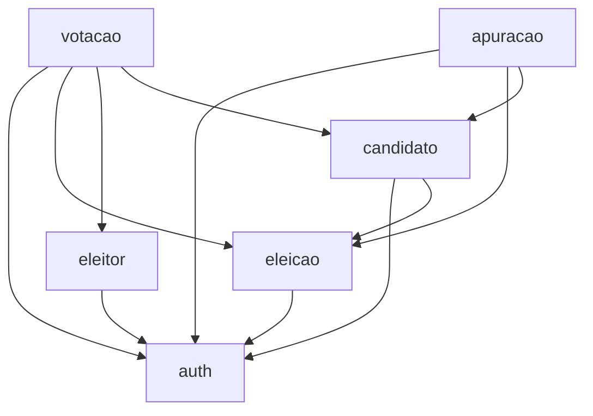
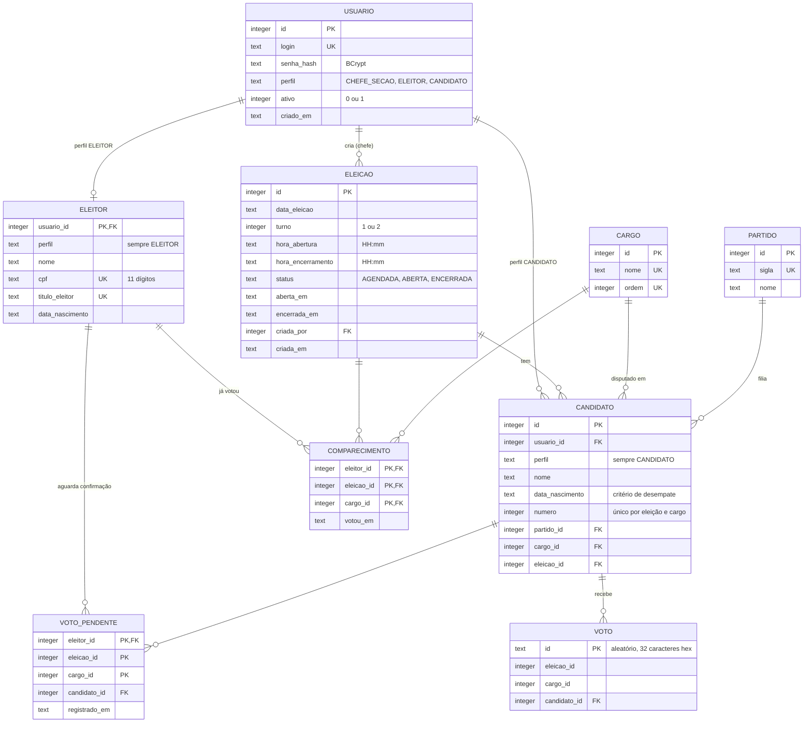

# es2-eleicao

API REST que simula uma eleição eletrônica: gerenciamento da eleição, cadastro de eleitores e candidatos, votação com sigilo, acompanhamento e resultado final. Há três perfis de usuário: Chefe da Seção, Eleitor e Candidato.

## Arquitetura

Tecnologias: Java 21, Spring Boot 4 (Web MVC, Security, Validation, Data JPA), SQLite, JWT (jjwt) e springdoc-openapi (Swagger UI).

A aplicação é um monólito modular em camadas. Cada requisição passa por:

1. **Segurança** (`config/SegurancaConfig`, `auth/service/FiltroJwt`): valida o token JWT e confere o perfil exigido pela rota. Sem token responde 401; perfil errado responde 403.
2. **Camada web** (`web`): controllers REST. Recebem e devolvem DTOs (`record`s), validam a entrada com Bean Validation e documentam a rota com anotações OpenAPI, que geram o Swagger UI.
3. **Camada de serviço** (`servico`): regras de negócio e transações (`@Transactional`).
4. **Camada de persistência** (`persistencia`): entidades JPA e repositórios Spring Data sobre o SQLite.

Os erros de negócio são exceções do pacote `shared` (`NaoEncontradoException`, `ConflitoException`, `RegraDeNegocioException`), convertidas pelo `TratadorDeErros` em respostas JSON com o código HTTP correto (404, 409, 422).

## Modularização

O código fica em `eleicao/src/main/java/br/unirio/eleicao`. Cada módulo de negócio é dono das suas tabelas e se divide em `web`, `servico` e `persistencia`.

| Módulo | Responsabilidade | Tabelas | Rotas |
|---|---|---|---|
| `auth` | Login, emissão e validação do JWT, contas de usuário | `usuario` | `POST /api/auth/login` (pública) |
| `eleicao` | Cadastro da eleição e estados AGENDADA → ABERTA → ENCERRADA | `eleicao` | `/api/eleicoes` (Chefe) |
| `eleitor` | Cadastro, alteração, consulta e exclusão de eleitores | `eleitor` | `/api/eleitores` (Chefe) |
| `candidato` | Candidatos e partidos, ligados a cargo e eleição | `candidato`, `partido` | `/api/candidatos`, `/api/partidos` (Chefe) |
| `votacao` | Consulta de candidatos, registro e confirmação do voto, sigilo | `voto_pendente`, `comparecimento`, `voto` | `/api/votacao` (Eleitor) |
| `apuracao` | Acompanhamento durante a votação e resultado final | view `vw_apuracao` (somente leitura) | `/api/apuracao` (Eleitor, Candidato, Chefe) |
| `config` | Segurança, Swagger, criação do Chefe inicial | | |
| `shared` | Enums (`Cargo`, `Perfil`, `StatusEleicao`), exceções, conversores de data e tratador de erros | | |

O módulo `auth` mantém a divisão `controller/service/repository`, com o mesmo papel das camadas `web/servico/persistencia`.

### Dependências entre módulos

"A --> B" significa que A chama o serviço público de B. Não há dependência circular. As regras seguidas:

- Um módulo só usa o `Servico` e os DTOs de outro módulo, nunca o repositório nem a entidade dele.
- Controllers nunca devolvem entidades JPA, só DTOs.
- Entre módulos, as referências são por id (`Long`), sem `@ManyToOne` entre entidades de módulos diferentes.
- Regras que vários módulos precisam ficam num único lugar. Por exemplo, `EleicaoServico.exigirStatus(id, status)` é usado pela votação, pelos candidatos e pela apuração em vez de cada um comparar o status.

## Modelagem do banco de dados

Banco: SQLite 3 (driver `sqlite-jdbc` 3.46, dialeto `SQLiteDialect` do Hibernate). O script de criação está em [eleicao/src/main/resources/db/schema-sqlite.sql](eleicao/src/main/resources/db/schema-sqlite.sql) e roda a cada inicialização da aplicação (`spring.sql.init.mode=always`). O Hibernate não gera tabelas (`ddl-auto=none`).

### Diagrama entidade-relacionamento

`COMPARECIMENTO` e `VOTO` não têm nenhuma ligação entre si. Isso é o que garante o sigilo (veja "Como o sigilo do voto é garantido").

### Descrição das tabelas

| Tabela | Finalidade | Principais restrições |
|---|---|---|
| `usuario` | Login e perfil de todos os usuários (Chefe da Seção, Eleitor, Candidato). | `login` único. `perfil` limitado aos três valores. Senha guardada como hash BCrypt. O par (`id`, `perfil`) é único para servir de alvo às chaves estrangeiras de `eleitor` e `candidato`. |
| `eleitor` | Dados do eleitor (nome, CPF, título, nascimento). | CPF com 11 caracteres e único. Título único. A coluna `perfil` é fixa em `ELEITOR` e a chave estrangeira composta (`usuario_id`, `perfil`) só aceita usuário com esse perfil. Apagar o usuário apaga o eleitor (`ON DELETE CASCADE`). |
| `eleicao` | Eleição com data, turno, horários e situação. | Data e turno únicos. Encerramento depois da abertura. Situação em AGENDADA, ABERTA ou ENCERRADA, coerente com `aberta_em` e `encerrada_em` (`ck_eleicao_status_datas`). |
| `cargo` | Os 5 cargos (Dep. Estadual, Dep. Federal, Senador, Governador, Presidente). | Carga inicial no script. Os mesmos ids estão no enum `Cargo` da aplicação. |
| `partido` | Partidos. | Sigla única. |
| `candidato` | Candidatura: pessoa concorrendo a um cargo em uma eleição, com número, partido e data de nascimento. | Número positivo e único por eleição e cargo. Mesma pessoa só concorre uma vez por eleição. Coluna `perfil` fixa em `CANDIDATO`, com chave estrangeira composta para `usuario`. O trio (`id`, `eleicao_id`, `cargo_id`) é único para servir de alvo às chaves de `voto` e `voto_pendente`. |
| `voto_pendente` | Voto registrado e ainda não confirmado. | Um por eleitor, eleição e cargo (chave primária). Apagado na confirmação. Apagado junto com o eleitor ou o candidato (`ON DELETE CASCADE`). |
| `comparecimento` | Registra quem já votou em cada cargo. Não guarda o candidato. | Chave primária (eleitor, eleição, cargo) impede voto duplicado. |
| `voto` | Voto confirmado. Guarda o candidato, mas não o eleitor. | O candidato precisa pertencer à eleição e ao cargo do voto (chave estrangeira composta). |

A view `vw_apuracao` traz os votos confirmados por candidato, com zero para quem não recebeu, e os dados do candidato (número, nome, partido, data de nascimento, ordem do cargo). Ela é mapeada na entidade somente leitura `ApuracaoCandidato` e serve tanto ao acompanhamento quanto ao resultado final. O mais votado de cada cargo é calculado pela API sobre essa view: em empate de votos, vence o candidato mais velho e, se nasceram no mesmo dia, o de menor número.

### Como o sigilo do voto é garantido

1. O eleitor registra o voto e ele fica em `voto_pendente`, ligado ao eleitor, porque só ele pode confirmar.
2. Na confirmação, uma única transação (`VotoServico.confirmar`) insere o eleitor em `comparecimento`, insere o voto em `voto` e apaga o registro de `voto_pendente`. Se qualquer passo falhar, os três são desfeitos.
3. Depois disso, `comparecimento` diz que o eleitor votou naquele cargo, e `voto` diz que alguém votou naquele candidato. Nenhuma coluna liga uma tabela à outra.
4. `voto` não guarda data e hora, e seu identificador é aleatório, para que a ordem dos registros não permita cruzar com `comparecimento`.
5. A API não tem nenhuma rota que devolva o voto ou o pendente de um eleitor. Registrar e confirmar respondem sem corpo.

Limite dessa abordagem: entre registrar e confirmar, o voto pendente está ligado ao eleitor. É um intervalo curto, e o registro some na confirmação. Acesso direto ao arquivo do banco ou a backups nesse intervalo revelaria a escolha.

### Funcionalidades do enunciado e as tabelas usadas

| Funcionalidade | Tabelas e views |
|---|---|
| 1. Autenticação | `usuario` (login, hash da senha e perfil) |
| 2. Gerenciamento da eleição | `eleicao` |
| 3. Gerenciamento de eleitores | `usuario` + `eleitor` |
| 4. Gerenciamento de candidatos | `usuario` + `candidato`, com `cargo`, `partido` e `eleicao` |
| 5. Votação | `candidato` (consulta por cargo), `voto_pendente`, `comparecimento`, `voto` |
| 6. Acompanhamento da votação | `vw_apuracao` |
| 7. Resultado da eleição | `vw_apuracao`, com o mais votado calculado na API |
